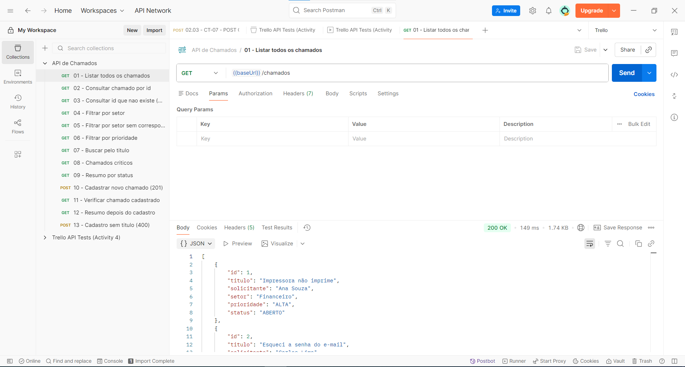
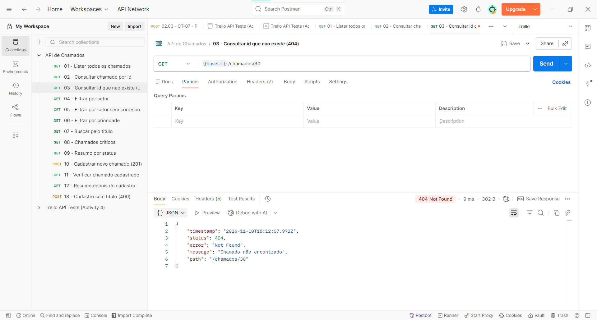
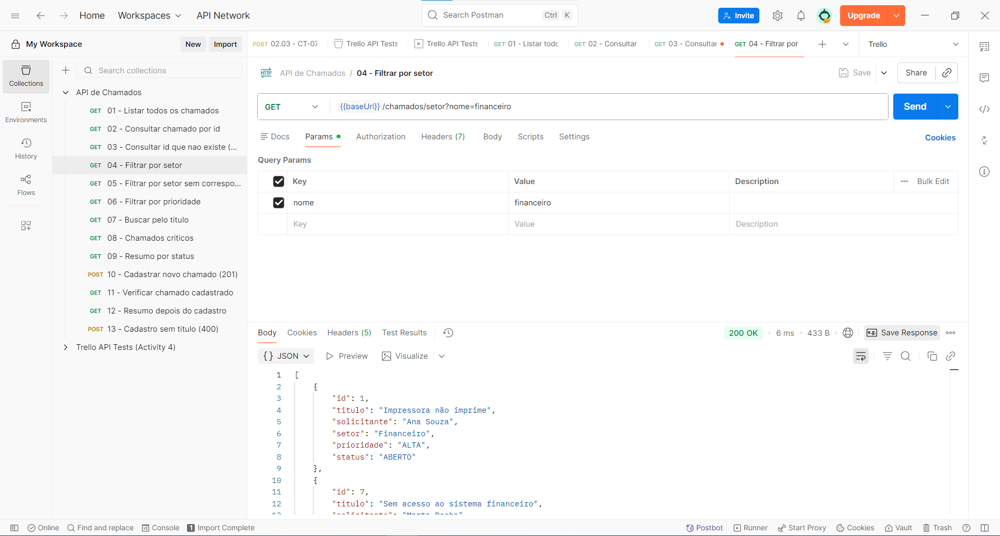
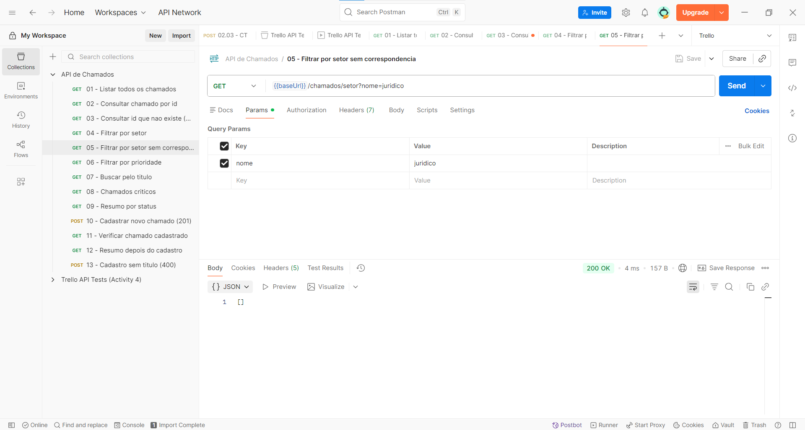
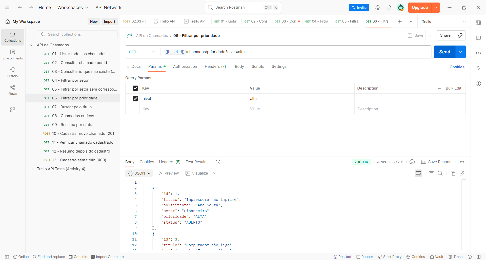
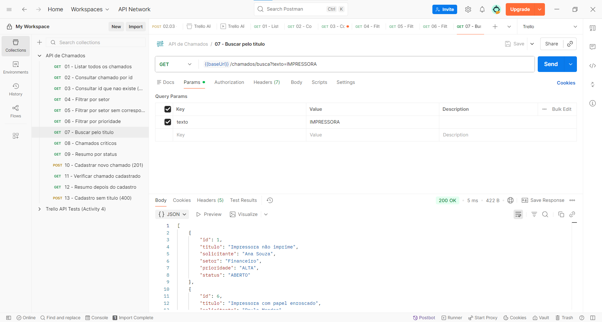
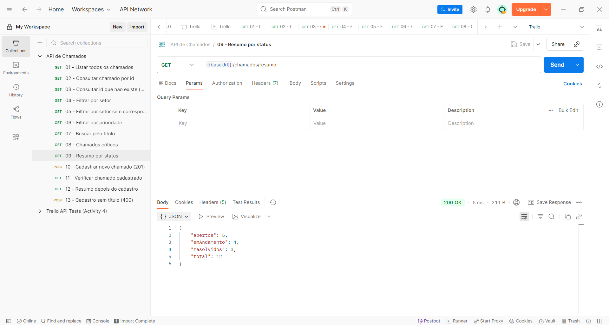
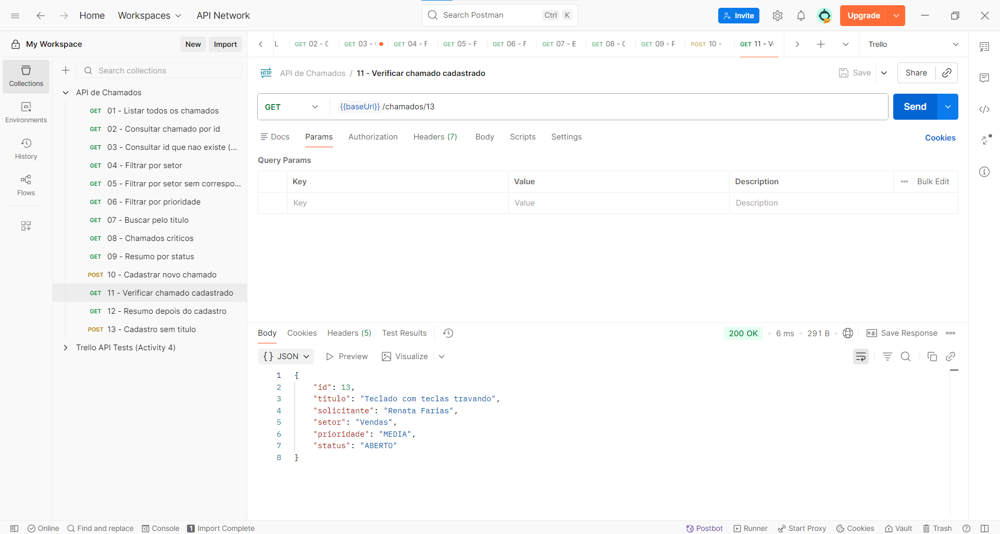
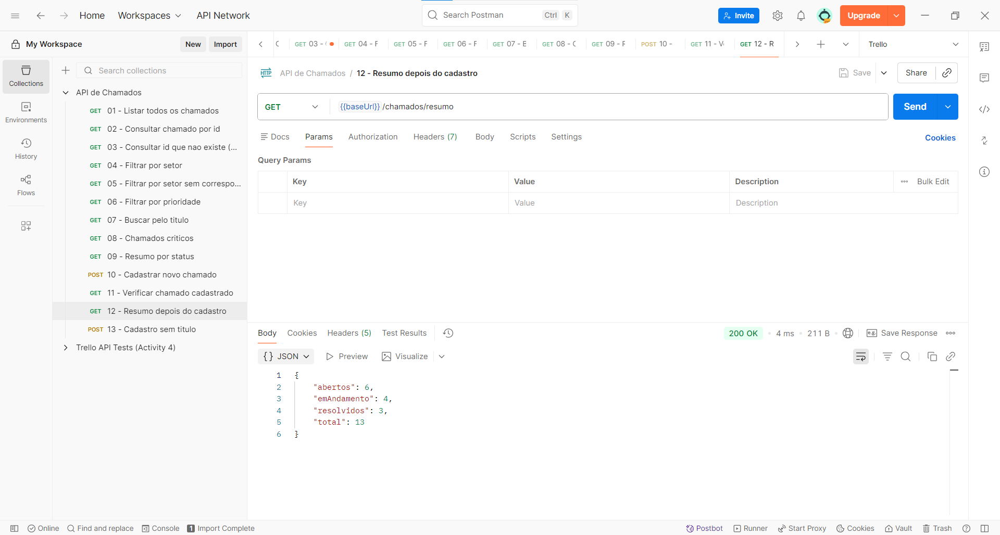
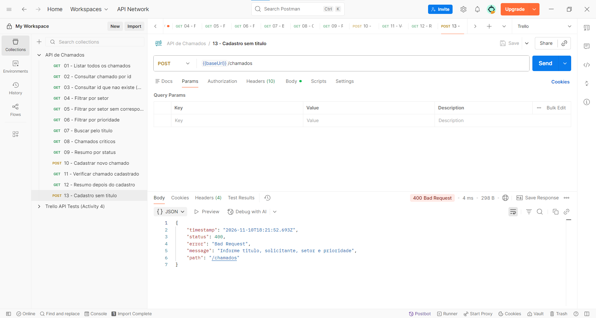

# API de Chamados de Suporte

Trabalho da disciplina Linguagens para Aplicação Comercial (MATC76).

API REST feita com Java e Spring Boot para registrar e consultar chamados de suporte técnico. Os dados ficam só em memória (uma `List` dentro do controller), sem banco de dados.

## Como rodar

Precisa do Java 21 e do Maven (ou usar o `mvnw` do projeto).

```bash
mvn spring-boot:run
```

A API sobe em `http://localhost:8080`.

## Estrutura

```
src/main/java/br/ufba/matc76/chamados
├── ChamadosApplication.java
├── controller
│   └── ChamadoController.java
└── model
    ├── Chamado.java
    ├── Prioridade.java
    └── Status.java
```

## Endpoints

| Método | Rota | O que faz |
|--------|------|-----------|
| GET | `/chamados` | lista todos os chamados |
| GET | `/chamados/{id}` | busca um chamado pelo id (404 se não existir) |
| GET | `/chamados/setor?nome=financeiro` | filtra pelo setor |
| GET | `/chamados/prioridade?nivel=alta` | filtra pela prioridade |
| GET | `/chamados/busca?texto=impressora` | busca pelo título |
| GET | `/chamados/criticos` | prioridade ALTA e status diferente de RESOLVIDO |
| GET | `/chamados/resumo` | quantidade de chamados por status e total |
| POST | `/chamados` | cadastra um chamado (retorna 201) |

As buscas por setor, prioridade e título não diferenciam maiúsculas de minúsculas.

Exemplo de JSON para cadastrar:

```json
{
  "titulo": "Teclado com teclas travando",
  "solicitante": "Renata Farias",
  "setor": "Vendas",
  "prioridade": "MEDIA"
}
```

`titulo`, `solicitante`, `setor` e `prioridade` são obrigatórios. O `status` é opcional e, se não for enviado, o chamado começa como `ABERTO`. O `id` é gerado pela API.

## Análise técnica

### Como o Spring Boot recebe e processa requisições HTTP

Ao iniciar, o Spring Boot sobe um servidor web embutido (Tomcat) na porta 8080. Quando chega uma requisição, o Tomcat entrega ela para o `DispatcherServlet` do Spring MVC. Ele olha o método HTTP e o caminho (por exemplo `GET /chamados/setor`) e descobre qual método do controller foi mapeado para essa rota com `@GetMapping`, `@PostMapping` etc. Depois disso o Spring monta os parâmetros do método (`@RequestParam`, `@PathVariable`, `@RequestBody`), chama o método e transforma o retorno em resposta HTTP, com status, cabeçalhos e corpo.

### Função do Controller

O `ChamadoController` é a classe que recebe as requisições da API. Ele é marcado com `@RestController` e `@RequestMapping("/chamados")`, então todas as rotas começam com `/chamados`. Cada método cuida de um endpoint: pega os dados da requisição, faz o filtro ou o cadastro na lista de chamados e devolve o resultado. Como o trabalho não pede Service nem Repository, a lista de chamados também fica dentro do controller.

### Conversão entre objetos Java e JSON

Essa conversão é feita automaticamente pela biblioteca Jackson, que já vem junto com o `spring-boot-starter-webmvc`. Quando um método devolve um `Chamado` ou uma `List<Chamado>`, o Jackson transforma o objeto em JSON usando os campos do `record` (`id`, `titulo`, etc.) e os enums viram texto (`"ALTA"`, `"ABERTO"`). No sentido contrário, no `POST`, o `@RequestBody` faz o Jackson ler o JSON recebido e criar um objeto `Chamado`. Se o JSON tiver um valor inválido, por exemplo uma prioridade que não existe, o Spring responde 400.

### Por que os chamados cadastrados somem ao reiniciar

Os chamados ficam numa `ArrayList` que é um atributo do controller, ou seja, só existem na memória RAM enquanto a aplicação está rodando. Ao reiniciar, a JVM começa do zero, o controller é criado de novo e a lista volta só com os 12 chamados iniciais do código. Como não existe banco de dados nem arquivo, nada é gravado em disco. Isso foi testado (último teste abaixo).

## Testes realizados

Cada teste tem a resposta em texto, copiada da execução na API rodando localmente, e o print da mesma requisição feita no Postman. A coleção do Postman está em `postman/chamados.postman_collection.json`. O teste 14 (reinício da aplicação) só tem a resposta em texto.

### 1. Listar todos os chamados

```
GET /chamados
```

Resposta `200 OK`:

```json
[
  {"id": 1, "titulo": "Impressora não imprime", "solicitante": "Ana Souza", "setor": "Financeiro", "prioridade": "ALTA", "status": "ABERTO"},
  {"id": 2, "titulo": "Esqueci a senha do e-mail", "solicitante": "Carlos Lima", "setor": "RH", "prioridade": "BAIXA", "status": "RESOLVIDO"},
  {"id": 3, "titulo": "Computador não liga", "solicitante": "Fernanda Alves", "setor": "Vendas", "prioridade": "ALTA", "status": "EM_ANDAMENTO"},
  {"id": 4, "titulo": "Internet lenta no setor", "solicitante": "Roberto Dias", "setor": "Marketing", "prioridade": "MEDIA", "status": "ABERTO"},
  {"id": 5, "titulo": "Instalar o Excel no notebook novo", "solicitante": "Juliana Costa", "setor": "Compras", "prioridade": "BAIXA", "status": "EM_ANDAMENTO"},
  {"id": 6, "titulo": "Impressora com papel enroscado", "solicitante": "Paulo Mendes", "setor": "RH", "prioridade": "MEDIA", "status": "RESOLVIDO"},
  {"id": 7, "titulo": "Sem acesso ao sistema financeiro", "solicitante": "Marta Rocha", "setor": "Financeiro", "prioridade": "ALTA", "status": "EM_ANDAMENTO"},
  {"id": 8, "titulo": "Rede caiu na sala de reunião", "solicitante": "Diego Martins", "setor": "Diretoria", "prioridade": "ALTA", "status": "RESOLVIDO"},
  {"id": 9, "titulo": "Trocar mouse quebrado", "solicitante": "Larissa Gomes", "setor": "Vendas", "prioridade": "BAIXA", "status": "ABERTO"},
  {"id": 10, "titulo": "VPN não conecta", "solicitante": "Bruno Teixeira", "setor": "Compras", "prioridade": "ALTA", "status": "ABERTO"},
  {"id": 11, "titulo": "Monitor piscando", "solicitante": "Camila Ribeiro", "setor": "Marketing", "prioridade": "MEDIA", "status": "EM_ANDAMENTO"},
  {"id": 12, "titulo": "Criar conta de acesso para novo estagiário", "solicitante": "Eduardo Pinto", "setor": "RH", "prioridade": "MEDIA", "status": "ABERTO"}
]
```

Retornou os 12 chamados que a aplicação carrega ao iniciar, com setores, prioridades e status variados.



### 2. Consultar chamado por id

```
GET /chamados/3
```

Resposta `200 OK`:

```json
{
  "id": 3,
  "titulo": "Computador não liga",
  "solicitante": "Fernanda Alves",
  "setor": "Vendas",
  "prioridade": "ALTA",
  "status": "EM_ANDAMENTO"
}
```

Encontrou o chamado de id 3.


### 3. Consultar id que não existe

```
GET /chamados/30
```

Resposta `404 Not Found`:

```json
{
  "timestamp": "2026-11-10T18:12:07.972Z",
  "status": 404,
  "error": "Not Found",
  "message": "Chamado não encontrado",
  "path": "/chamados/30"
}
```

Não existe chamado com id 30, então a API responde 404 com uma mensagem.



### 4. Filtrar por setor

```
GET /chamados/setor?nome=financeiro
```

Resposta `200 OK`:

```json
[
  {"id": 1, "titulo": "Impressora não imprime", "solicitante": "Ana Souza", "setor": "Financeiro", "prioridade": "ALTA", "status": "ABERTO"},
  {"id": 7, "titulo": "Sem acesso ao sistema financeiro", "solicitante": "Marta Rocha", "setor": "Financeiro", "prioridade": "ALTA", "status": "EM_ANDAMENTO"}
]
```

Mesmo escrevendo "financeiro" em minúsculo, a busca achou os chamados do setor "Financeiro".



### 5. Filtrar por setor sem correspondência

```
GET /chamados/setor?nome=juridico
```

Resposta `200 OK`:

```json
[]
```

Nenhum chamado é do setor Jurídico, então volta uma lista vazia.



### 6. Filtrar por prioridade

```
GET /chamados/prioridade?nivel=alta
```

Resposta `200 OK`:

```json
[
  {"id": 1, "titulo": "Impressora não imprime", "solicitante": "Ana Souza", "setor": "Financeiro", "prioridade": "ALTA", "status": "ABERTO"},
  {"id": 3, "titulo": "Computador não liga", "solicitante": "Fernanda Alves", "setor": "Vendas", "prioridade": "ALTA", "status": "EM_ANDAMENTO"},
  {"id": 7, "titulo": "Sem acesso ao sistema financeiro", "solicitante": "Marta Rocha", "setor": "Financeiro", "prioridade": "ALTA", "status": "EM_ANDAMENTO"},
  {"id": 8, "titulo": "Rede caiu na sala de reunião", "solicitante": "Diego Martins", "setor": "Diretoria", "prioridade": "ALTA", "status": "RESOLVIDO"},
  {"id": 10, "titulo": "VPN não conecta", "solicitante": "Bruno Teixeira", "setor": "Compras", "prioridade": "ALTA", "status": "ABERTO"}
]
```

Retornou os 5 chamados de prioridade ALTA, inclusive o que já está resolvido (id 8).



### 7. Buscar pelo título

```
GET /chamados/busca?texto=IMPRESSORA
```

Resposta `200 OK`:

```json
[
  {"id": 1, "titulo": "Impressora não imprime", "solicitante": "Ana Souza", "setor": "Financeiro", "prioridade": "ALTA", "status": "ABERTO"},
  {"id": 6, "titulo": "Impressora com papel enroscado", "solicitante": "Paulo Mendes", "setor": "RH", "prioridade": "MEDIA", "status": "RESOLVIDO"}
]
```

O texto foi enviado em maiúsculo e mesmo assim achou os títulos com "Impressora".



### 8. Chamados críticos

```
GET /chamados/criticos
```

Resposta `200 OK`:

```json
[
  {"id": 1, "titulo": "Impressora não imprime", "solicitante": "Ana Souza", "setor": "Financeiro", "prioridade": "ALTA", "status": "ABERTO"},
  {"id": 3, "titulo": "Computador não liga", "solicitante": "Fernanda Alves", "setor": "Vendas", "prioridade": "ALTA", "status": "EM_ANDAMENTO"},
  {"id": 7, "titulo": "Sem acesso ao sistema financeiro", "solicitante": "Marta Rocha", "setor": "Financeiro", "prioridade": "ALTA", "status": "EM_ANDAMENTO"},
  {"id": 10, "titulo": "VPN não conecta", "solicitante": "Bruno Teixeira", "setor": "Compras", "prioridade": "ALTA", "status": "ABERTO"}
]
```

São os chamados de prioridade ALTA que ainda não foram resolvidos. Comparado com o teste 6, o chamado 8 ficou de fora porque está RESOLVIDO.


### 9. Resumo por status

```
GET /chamados/resumo
```

Resposta `200 OK`:

```json
{
  "abertos": 5,
  "emAndamento": 4,
  "resolvidos": 3,
  "total": 12
}
```

Quantidade de chamados em cada status e o total geral.



### 10. Cadastrar um novo chamado

```
POST /chamados
Content-Type: application/json

{"titulo":"Teclado com teclas travando","solicitante":"Renata Farias","setor":"Vendas","prioridade":"MEDIA"}
```

Resposta `201 Created`:

```json
{
  "id": 13,
  "titulo": "Teclado com teclas travando",
  "solicitante": "Renata Farias",
  "setor": "Vendas",
  "prioridade": "MEDIA",
  "status": "ABERTO"
}
```

A API gerou o id 13 e, como o status não foi enviado, o chamado entrou como ABERTO.


### 11. Verificar o chamado cadastrado

```
GET /chamados/13
```

Resposta `200 OK`:

```json
{
  "id": 13,
  "titulo": "Teclado com teclas travando",
  "solicitante": "Renata Farias",
  "setor": "Vendas",
  "prioridade": "MEDIA",
  "status": "ABERTO"
}
```

O chamado cadastrado no teste anterior pode ser consultado pelo id.



### 12. Resumo depois do cadastro

```
GET /chamados/resumo
```

Resposta `200 OK`:

```json
{
  "abertos": 6,
  "emAndamento": 4,
  "resolvidos": 3,
  "total": 13
}
```

Os abertos subiram de 5 para 6 e o total de 12 para 13.



### 13. Cadastro sem título

```
POST /chamados
Content-Type: application/json

{"solicitante":"Renata Farias","setor":"Vendas","prioridade":"MEDIA"}
```

Resposta `400 Bad Request`:

```json
{
  "timestamp": "2026-11-10T18:21:52.693Z",
  "status": 400,
  "error": "Bad Request",
  "message": "Informe titulo, solicitante, setor e prioridade",
  "path": "/chamados"
}
```

Sem o título o cadastro é recusado e nada é adicionado à lista.



### 14. Dados depois de reiniciar a aplicação

Depois de parar e iniciar a API de novo:

```
GET /chamados/13
```

Resposta `404 Not Found`:

```json
{
  "timestamp": "2026-11-10T13:15:09.182Z",
  "status": 404,
  "error": "Not Found",
  "message": "Chamado não encontrado",
  "path": "/chamados/13"
}
```

```
GET /chamados/resumo
```

Resposta `200 OK`:

```json
{"abertos":5,"emAndamento":4,"resolvidos":3,"total":12}
```

O chamado 13 sumiu e o total voltou para 12, porque os dados estavam só em memória.
